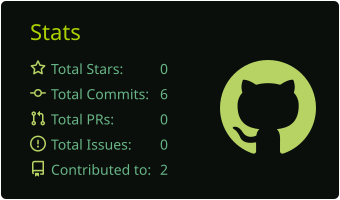
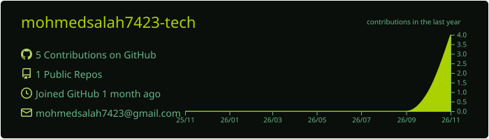

<div align="center">

<a href="https://github.com/YOUR_GITHUB_USERNAME">
  
</a>
<br>

<br>


[](https://www.linkedin.com/in/YOUR_LINKEDIN)
[](mailto:YOUR_EMAIL@example.com)

</div>

<hr></hr>


```python
# tools_I_use organized

class About(Me):
    my_tools = {
        "Programming Languages": ["Python", "C++", "Java"],
        "AI & Machine Learning": ["PyTorch", "TensorFlow", "Keras", "scikit-learn"],
        "Data Science": ["NumPy", "Pandas", "Matplotlib", "Seaborn"],
        "Computer Vision & NLP": ["OpenCV", "Hugging Face", "NLTK"],
        "Databases": ["SQL", "SQLite"],
        "Editors & Environments": ["VS Code", "Jupyter Notebook", "Google Colab"],
        "Other Tools": ["Git", "GitHub", "Linux"],
    }
```

-   &nbsp; I'm currently learning **Machine Learning & Deep Learning**. <br>
- &nbsp;&nbsp;&nbsp; I like exploring **GNU/Linux**. <br>
- &nbsp;&nbsp; Ask me about **AI, Programming, or anything**. <br>
-  &nbsp; Find me on LinkedIn: **[Mohamed Salah](https://www.linkedin.com/in/YOUR_LINKEDIN)**<br>
- &nbsp;&nbsp;&nbsp;&nbsp;&nbsp;&nbsp;Fun fact: Training a model for hours only to find a typo in the data path is a rite of passage.<br>

<div align="center">
<a href="https://github.com/YOUR_GITHUB_USERNAME">


</a>

<details>
  <summary>More stats</summary>


</details>

<hr></hr>

**Code Cycle**<br>


&nbsp;&nbsp;&nbsp;&nbsp;&nbsp;

&nbsp;&nbsp;&nbsp;&nbsp;&nbsp;
<br>

</div>

<hr>

<div align="center">

<h2>📊 GitHub Statistics</h2>




<details>
<summary>More Stats</summary>
<br>

</details>

</div>
يعني احطه اسفل الكود بتاع ال readme
