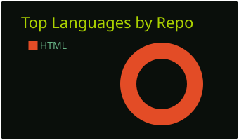
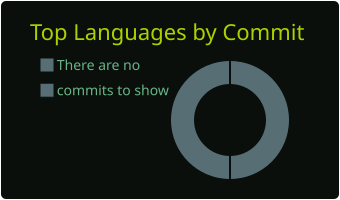

 

 

## 🚀 Tech Stack

### 💻 Programming Languages

### 🌐 Web

### 🧠 AI & Machine Learning

### 📊 Data & Computer Vision

### 🛠️ Frameworks & Tools

-  I'm currently learning **Machine Learning & Deep Learning**.
-  I like exploring **GNU/Linux**.
-  Ask me about **AI, Programming, or anything**.
-  Find me on LinkedIn: [**Mohamed Salah**](https://www.linkedin.com/in/mohmed-salah-2738482b9)
-  Fun fact: Training a model for hours only to find a typo in the data path is a rite of passage.

<h2>📊 GitHub Statistics</h2>

More Stats

 

